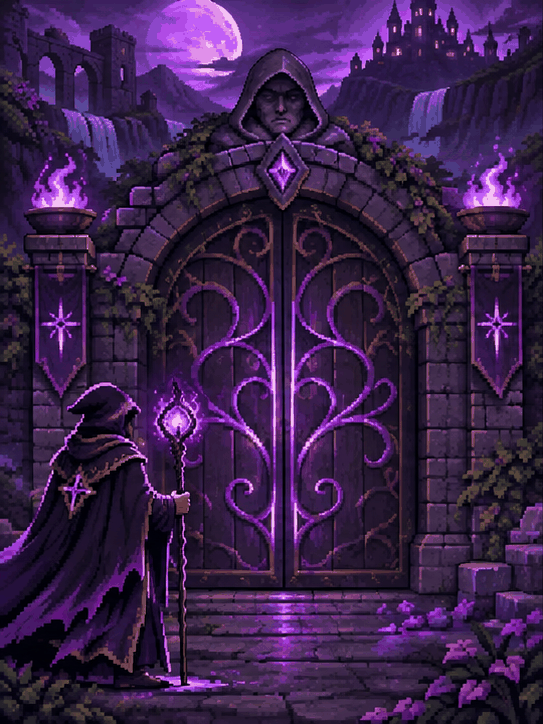

  

<h1 align="center">Olá, eu sou Matheus Santos 👋🏾</h1>

<strong>Desenvolvimento backend · Infraestrutura · Em evolução para full stack</strong>

Sou profissional de TI e desenvolvedor em formação. Gosto de entender os problemas de ponta a ponta — da infraestrutura à aplicação — e criar soluções que tornem o trabalho mais simples, organizado e seguro. Trabalho com sistemas, redes e suporte, enquanto amplio meus conhecimentos de desenvolvimento web e construção de produtos.

## 🛠️ Tecnologias e conhecimentos

**Desenvolvimento e dados**

**Ferramentas e infraestrutura**

Tenho experiência com automação, bancos de dados relacionais, testes, segurança aplicada e suporte a ambientes de TI. Também venho explorando **FastAPI, React e PostgreSQL** em projetos pessoais como parte da minha jornada full stack.

## 🧩 Projetos em destaque

### Projetos públicos

- **[SIGATC Compact — gestão de ativos de TI](https://github.com/MtheusM2/Sigatccompact)** · TCC que transforma controles manuais em um sistema web com autenticação, perfis de acesso e rastreabilidade. Atuei no backend, banco de dados, segurança, testes e documentação técnica. `Python` `Flask` `MySQL` `pytest`
- **[Chamado — alertas em rede local](https://github.com/MtheusM2/Chamado)** · Sistema cliente-servidor usado para facilitar a comunicação entre computadores em uma farmácia, com chamados, alertas e descoberta de servidor na rede. `Python` `Tkinter` `SQLite`

### Projetos privados

- **Controle de ativos** · Sistema corporativo em uso que centraliza o inventário e a movimentação de equipamentos, reduzindo a dependência de planilhas e facilitando a rastreabilidade. `Python` `Flask` `MySQL`
- **Planejamento financeiro pessoal** · Aplicação web para organizar receitas, despesas, objetivos e projeções financeiras familiares. `Python` `FastAPI` `React` `PostgreSQL` `Docker`
- **Análise de leads de marketing** · Projeto de dashboard para reunir e visualizar informações de campanhas; seu desenvolvimento foi interrompido. `Python` `Streamlit` `MySQL`

Os projetos privados permanecem protegidos; seus resumos mostram os problemas e as soluções sem expor código ou dados internos.

## 📫 Vamos conversar?

## 🪄 O guardião do portal

> Dizem que, no fim deste reino, um mago de capuz guarda os projetos que ainda não podem ser revelados. Atrás do portão, o rei mago segue estudando, criando e aperfeiçoando suas habilidades. Cada desafio é um novo feitiço; cada aprendizado, um passo para dominar diferentes classes e se tornar um desenvolvedor full stack.

  

